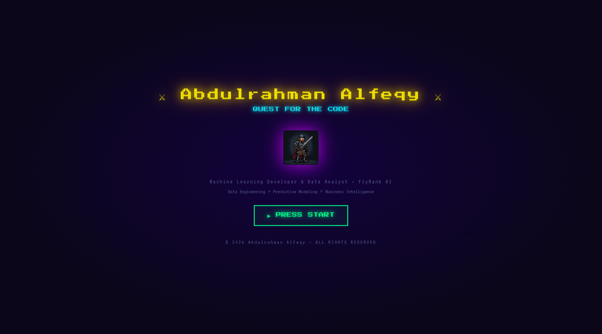

# ⚔️ Quest for the Code

**An Interactive RPG-Style Developer Portfolio**

---

## 🎮 What Is This?

Quest for the Code is a free, open-source developer portfolio built entirely with **vanilla HTML, CSS, and JavaScript** — no frameworks, no build tools, no dependencies. Instead of a boring resume-style page, your portfolio is a fully interactive RPG game world where visitors explore different zones to learn about you.

---

## 🔗 Quick Links

| Resource | URL |
|----------|-----|
| 💻 GitHub Repo | https://github.com/Abdulrahman-Alfeqy |
| 💼 LinkedIn | https://www.linkedin.com/in/abdulrahman-atef-424710337 |

---

## ✨ Features

- 🗺️ **RPG Game World** — explore 8 interactive zones via a world map
- 📡 **Live GitHub Data** — repos & follower count auto-fetch from the GitHub API on every visit
- 📬 **Working Contact Form** — powered by Formspree, lands directly in your inbox
- ⭐ **Animated Starfield** — Canvas API background with 200 twinkling stars
- 🎮 **XP System** — visitors earn XP for exploring each zone
- 🖥️ **HUD Interface** — HP/XP bars, level display, breadcrumb navigation
- 🔒 **Privacy-First** — contact routing setup.
- 🎵 **♪ ANTHEM** — ambient RPG background music
- ✦ **SPELL** — click sounds, zone enter chimes, XP gain pings, PRESS START fanfare
- 🔈 **Audio Controls in HUD** — Zero external audio files.
- 📱 **Fully Responsive** — mobile, tablet, and desktop support
- ⚡ **Zero Dependencies** — 4 files, no npm, no build step, no framework

---

## 🏰 The 8 Zones

| Zone | Icon | Description |
|------|------|-------------|
| **CHARACTER** | 👤 | Profile, bio, and live GitHub stats |
| **SKILLS FORGE** | ⚡ | Animated skill bars and tech stack arsenal |
| **BATTLE LOG** | 💼 | Work experience timeline |
| **ARTIFACT HALL** | 🏗 | Projects with descriptions, tags, and GitHub links |
| **MERCENARY BOARD** | ✍️ | Freelance profiles |
| **ACADEMY** | 🎓 | Education and Certifications |
| **TROPHY VAULT** | 🏆 | Achievements, badges, and career stats |
| **SIGNAL TOWER** | 📡 | Contact links and message form |

---

**Built by Abdulrahman Alfeqy — no frameworks harmed in the making of this portfolio** ⚔️

